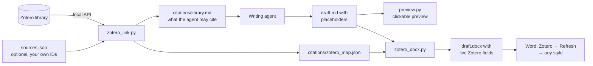

# Zotero connector for AI writing agents

Let an AI writing agent (Claude Code, or any LLM) cite your **Zotero** library, and get a
Word document with **live Zotero citations**: the same fields the Zotero Word plugin
inserts when you cite by hand. Click *Refresh* once and switch the citation style
(APA, IEEE, Harvard, Vancouver, a journal's own style…) whenever you like.

The agent never types a citation. It writes a short placeholder such as `{@P017}`, and
these scripts turn each placeholder into a Zotero field that holds the full reference data.
This has three benefits:

- **No invented references.** The agent can only cite IDs from a list made from your
  library, and the scripts reject any other ID.
- **Style changes in seconds.** Zotero formats everything, so you can change the style
  at any time.
- **Works not in your library still work.** A work you don't have in Zotero (for example
  one known only from another paper's reference list) carries its own data inside the
  citation, so it still cites correctly.

This toolkit was built for, and used in, a literature review of web applications in
architecture, engineering and construction (AEC). See [Citing](#citing).



---

## Contents
- [Requirements](#requirements)
- [Try it in two minutes (no Zotero needed)](#try-it-in-two-minutes-no-zotero-needed)
- [Use it with your Zotero library](#use-it-with-your-zotero-library)
- [Placeholder syntax](#placeholder-syntax)
- [Your own IDs vs. Zotero keys](#your-own-ids-vs-zotero-keys)
- [Connecting a writing agent](#connecting-a-writing-agent)
- [Citing in Word directly (no agent)](#citing-in-word-directly-no-agent)
- [How it works](#how-it-works)
- [Limitations](#limitations)
- [Repository layout](#repository-layout)

## Requirements
- Python 3.9 or newer, and `pip install -r requirements.txt` (only `python-docx`)
- [Zotero 7](https://www.zotero.org/download/) with the Word plugin, and Microsoft Word
- Optional: [Claude Code](https://docs.claude.com/en/docs/claude-code), for the ready-made
  agent and `/cite` command

```bash
git clone https://github.com/<your-account>/Zotero_connector.git
cd Zotero_connector
pip install -r requirements.txt
```

## Try it in two minutes (no Zotero needed)
The `examples/` folder has three made-up sources and a short draft that cites them.

```bash
python3 scripts/zotero_link.py --sources examples/sources.json --offline
python3 scripts/preview.py examples/draft.md
python3 scripts/zotero_docx.py examples/draft.md examples/draft.docx
```

Open `examples/draft.docx` in Word. In the Zotero tab, click **Refresh**. Then open
**Document Preferences**, pick another style, and watch every citation and the reference
list change. `examples/example_output.docx` is the same file, already built, if you want
to try the Word side first.

## Use it with your Zotero library

### 1. Let other programs talk to Zotero
Zotero 7 → *Settings* → *Advanced* → tick **"Allow other applications on this computer to
communicate with Zotero"**. This turns on Zotero's local API at `http://127.0.0.1:23119`.
It only answers programs on your own computer; nothing is sent anywhere.

Check it (Zotero must be running):
```bash
curl "http://127.0.0.1:23119/api/users/0/items/top?limit=1&format=csljson"
```

### 2. Build the citation map
```bash
python3 scripts/zotero_link.py                               # whole library
python3 scripts/zotero_link.py --collection "My review"      # or one collection
```
This writes two files:
- `citations/zotero_map.json`: every citable ID with its Zotero link and full
  reference data (CSL-JSON).
- `citations/library.md`: a short table of IDs, authors, years and titles. This is the
  list your writing agent reads to know what it may cite.

Run it again whenever you add items to Zotero.

### 3. Write with placeholders
Ask your agent to write in Markdown and cite with placeholders (see
[Connecting a writing agent](#connecting-a-writing-agent)), or type them yourself.

### 4. Preview (optional)
```bash
python3 scripts/preview.py drafts/introduction.md
```
This makes `drafts/preview/introduction.md`, where each citation shows as author–year.
Clicking a citation opens the item in Zotero. For a work that is not in Zotero, it opens
the PDF instead, if `sources.json` gives a `pdf` path. Unknown IDs are shown in bold as
`[UNKNOWN …]`. The preview ends with a list of the works cited.

### 5. Build the Word file
```bash
python3 scripts/zotero_docx.py drafts/introduction.md introduction.docx
# another starting style:
python3 scripts/zotero_docx.py drafts/introduction.md introduction.docx --style http://www.zotero.org/styles/ieee
```
The input can be Markdown or a `.docx` you already have. The script prints how many
citations it made, and lists any placeholder it could not convert. It never guesses an
unknown ID.

### 6. Refresh in Word
Open the `.docx` → **Zotero** tab → **Refresh**. From now on it's a normal Zotero
document: add citations by hand, change style in **Document Preferences**, and so on.
Style IDs are listed in the [Zotero Style Repository](https://www.zotero.org/styles).

## Placeholder syntax

| You want | Write | Shown as (APA) |
|---|---|---|
| One work | `{@P001}` | (Example et al., 2021) |
| Several works | `{@P001; @P002}` | (Example et al., 2021; Placeholder & Mock, 2023) |
| A page or other locator | `{@P002, p. 7}` · `{@P001, fig. 3}` · `{@P001, sec. 4.2}` | (Placeholder & Mock, 2023, p. 7) |
| Author as part of the sentence | `{@P002\|n} reported …` | Placeholder and Mock (2023) reported … |
| The reference list | a paragraph containing only `{BIBLIOGRAPHY}` | the Zotero bibliography |

Locator labels: `p.`, `pp.`, `ch.`, `sec.`, `fig.`, `tab.`, `para.`, `vol.`, `eq.`
(no label means page). An ID may contain letters, digits, `_`, `-` and `:`.

## Your own IDs vs. Zotero keys
You can cite works in two ways, and mix them freely.

**Zotero item keys (simplest).** Every Zotero item has an 8-character key, for example
`{@8XK2M4QZ}`. `library.md` lists them, and the agent cites them directly.

**Your own IDs (best for pipelines).** When agents first read your papers and take notes,
it's handier to give each paper a short ID such as `P017`. List them in a `sources.json`:

```json
[
  {"id": "P017", "title": "…", "authors": ["Smith, Jane", "Lee, Kim"], "year": 2021,
   "venue": "…", "volume": "12", "issue": "3", "pages": "101-118", "doi": "10.…",
   "pdf": "papers/Smith - 2021 - ….pdf"},
  {"id": "S0042", "title": "…", "authors": "Older, F.", "year": 2015}
]
```

```bash
python3 scripts/zotero_link.py --sources sources.json --collection "My review"
```
Each source is matched to your Zotero library by DOI, then by title (and year). The match
is not perfect, so check `citations/unmatched.txt`.
- **Matched:** the citation is linked to the Zotero item, exactly as if you had inserted it
  in Word.
- **Not matched:** the citation still works. Its reference data is stored in the Word file
  and Zotero formats it in any style. The script also writes `citations/unmatched.ris`. If
  you want, import it into Zotero and run `zotero_link.py` again to link these works too.

Only `id` and `title` are required. `authors` can be a list or a `;`-separated string.
`type` is any [CSL type](https://docs.citationstyles.org/en/stable/specification.html#appendix-iii-types)
(default `article-journal`).

## Connecting a writing agent

### Claude Code
Copy `.claude/` and `scripts/` into your project. You get:

- **`zotero-writer`** agent (`.claude/agents/zotero-writer.md`): writes one section at a
  time from your notes. It reads `citations/library.md`, cites only those IDs, and marks
  missing sources as `[CITATION NEEDED: …]` instead of inventing them.
- **`/cite`** command (`.claude/commands/cite.md`): refreshes the map, makes the preview,
  builds the `.docx`, and reports anything that failed.

Example session:
```
> Use the zotero-writer agent to write drafts/introduction.md (about 600 words) from
  notes/intro_notes.md. Cite only from citations/library.md.
> /cite drafts/introduction.md --collection "My review"
```

In a multi-agent pipeline (readers → writer → reviewer → assembler), give every agent the
same rule: *cite only with placeholders, never typed author–year text*. Run
`zotero_docx.py` once, at the very end, on the assembled manuscript. A reviewer agent can
check citations cheaply by grepping the draft for `{@…}` and comparing the IDs with
`zotero_map.json`.

### Any other LLM (ChatGPT, Gemini, a local model…)
Paste this into the system prompt or the start of the chat, and attach `citations/library.md`:

```text
Cite sources ONLY with placeholders, never with typed author–year text or numbers:
  {@ID}               one work            {@ID1; @ID2}   several works
  {@ID, p. 12}        with a page         {@ID|n}        author as subject ("{@ID|n} showed …")
Put the placeholder before the full stop. Use only IDs from the attached library.md.
If a claim needs a source that is not in the list, write [CITATION NEEDED: what] instead.
End the text with a paragraph containing only {BIBLIOGRAPHY}.
```
Save the answer as `.md`, then run steps 4–6.

## Citing in Word directly (no agent)
`zotero_docx.py` works on any `.docx`. You can type `{@P017}` while writing in Word, or
use a journal template, then run:
```bash
python3 scripts/zotero_docx.py manuscript.docx manuscript_zotero.docx
```
Word often splits typed text into several pieces behind the scenes (after spell-check or
edits). The script joins a placeholder's pieces back together before converting it.
Placeholders inside the body and inside tables are converted.

## How it works
A Zotero citation in Word is a field (`ADDIN ZOTERO_ITEM CSL_CITATION {…}`) whose code
holds JSON with each cited item's URI and full CSL-JSON data. The bibliography is another
field (`ADDIN ZOTERO_BIBL`). Document settings such as the style are stored as
`ZOTERO_PREF_n` custom document properties. `zotero_docx.py` writes exactly these
structures, so the plugin can't tell them apart from citations it inserted itself.

Every item gets a URI, even items that are not in your library. Without one, the plugin
fails with *"Zotero experienced an error updating your document"*. Details:
[docs/how-it-works.md](docs/how-it-works.md). Problems:
[docs/troubleshooting.md](docs/troubleshooting.md).

## Limitations
- **Personal library only:** `users/0` in the local API. Group libraries are not read.
- **Microsoft Word only:** tested with Zotero 7 on macOS. LibreOffice and Google Docs use
  different citation markers and are not supported.
- **Pre-rendered text:** citation text before the first *Refresh* is a simple APA
  approximation. Zotero replaces it on refresh.
- **Not converted:** placeholders in footnotes, headers and text boxes are left as they
  are. Footnote (note) styles have not been tested.
- **Custom properties:** existing custom document properties of an input `.docx` are
  replaced by Zotero's preferences.
- **Matching:** `sources.json` is matched by DOI and exact normalised title. Always check
  `unmatched.txt`.

## Repository layout
```
scripts/
  zotero_link.py     Zotero library (+ your sources) -> citations/zotero_map.json, library.md
  zotero_docx.py     placeholders in .md/.docx -> .docx with live Zotero fields
  md_to_docx.py      minimal Markdown -> .docx (used by zotero_docx.py)
  preview.py         clickable Markdown preview of a draft
.claude/
  agents/zotero-writer.md   Claude Code writing agent that cites with placeholders
  commands/cite.md          /cite: map -> preview -> .docx
examples/            made-up sources and a draft to try everything offline
docs/                how it works, troubleshooting
tests/               offline tests:  python3 -m unittest discover tests
```

## Citing
If you use this toolkit, please cite the review it was developed for:

> *[Reference to the review paper — to be added on publication.]*

## License
MIT. See [LICENSE](LICENSE). Zotero is a trademark of the Corporation for Digital
Scholarship. This project is not affiliated with Zotero.
